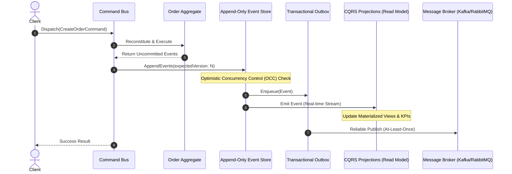

# EventFlux // Distributed Event Streaming & CQRS Architecture

> **Architect & Lead Engineer:** أ. طارق ابوعشي  
> **Repository:** `Tareq0001/EventFlux-CQRS-Stream`  
> **Live Interactive Workbench:** [https://tareq0001.github.io/EventFlux-CQRS-Stream/](https://tareq0001.github.io/EventFlux-CQRS-Stream/)

---

## 🏛️ Executive Architecture Summary

**EventFlux** is an enterprise-grade distributed software engineering architecture implementing **Event Sourcing**, **Command Query Responsibility Segregation (CQRS)**, and the **Transactional Outbox Pattern**. It decouples write-side aggregate state mutability from read-side projection throughput, guaranteeing linearizability and at-least-once downstream message publication.



---

## 🚀 Key Architectural Guarantees

1. **Immutable Append-Only Event Store:** State is never overwritten or mutated; history is an append-only log of domain occurrences.
2. **Optimistic Concurrency Control (OCC):** Prevents lost updates using atomic version checks:
   $$\text{Version}_{\text{expected}} = \text{Version}_{\text{current}}$$
3. **Transactional Outbox Pattern:** Ensures dual-write consistency between the event persistence layer and asynchronous message brokers without distributed two-phase commit (2PC) bottlenecks.
4. **Instant Event Rehydration:** Aggregates can replay events from inception or snapshot offsets in $O(E)$ time:
   $$S_t = f(S_0, E_1, E_2, \dots, E_t)$$
5. **High-Read Throughput Projections:** Decoupled Read Models serve queries directly from memory-optimized materialized views without touching aggregate tables.

---

## 📁 Repository Structure

```text
EventFlux-CQRS-Stream/
├── .github/workflows/
│   └── ci.yml               # Automated CI test suite
├── src/
│   ├── domain/
│   │   ├── event.js         # Immutable Domain Events
│   │   └── aggregate.js     # Aggregate Root & Invariant Validation
│   ├── application/
│   │   └── command-bus.js   # Command Bus & Mediation Handlers
│   └── infrastructure/
│       ├── event-store.js   # Append-Only Store with OCC & Snapshots
│       ├── outbox-processor.js # Reliable Transactional Outbox
│       └── projection-engine.js # Real-time Read Models & Materialized Views
├── tests/
│   └── eventflux.test.js    # Comprehensive Unit Test Suite
├── index.html               # Live Interactive Monitoring Workbench
├── Dockerfile               # Containerized Runner
└── package.json
```

---

## 🧪 Running Tests & Local Execution

```bash
# Run unit tests
npm test

# Run via Docker
docker build -t eventflux-cqrs .
docker run --rm eventflux-cqrs
```

---

## 🏛️ Author & Attribution

**أ. طارق ابوعشي**  
*استشاري ومعماري هندسة البرمجيات والأنظمة الموزعة*  
*Abha, Saudi Arabia*
